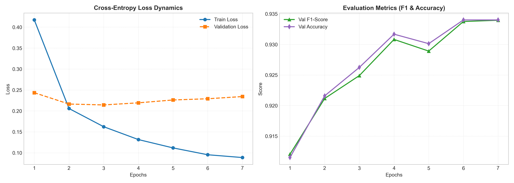

# 🛡️ High-Precision Product Watermark Detection via ConvNeXt-Tiny

[](https://pytorch.org/)
[](https://pytorch.org/vision/)
[](https://python.org)
[](LICENSE)
[](#-benchmark-and-results)

An end-to-end, high-throughput deep learning pipeline designed to detect visual artifacts, brand logos, and digital watermarks superimposed on high-resolution e-commerce catalog imagery. Built on top of the **ConvNeXt-Tiny** architecture, leveraging **Differential Learning Rates**, **Automatic Mixed Precision (AMP)**, and robust image sanitization routines.

---

## 📌 Architectural Overview & Motivation

Digital watermarks in enterprise e-commerce datasets exhibit extreme variance across multiple dimensions:
1. **Spatial Scale & Alpha Blending:** Ranging from faint, semi-transparent central overlays to sharp, peripheral vector watermarks.
2. **Color Profile Discrepancies:** Raw catalog streams often contain corrupted headers, single-channel (`L`), or 4-channel (`CMYK`) formats.

While traditional Vision Transformers (ViTs) incur quadratic computational complexity $\mathcal{O}(N^2)$ at higher spatial resolutions, **ConvNeXt** modernizes standard convolutional networks using inverted bottlenecks, $7 \times 7$ depthwise convolutions, and micro-design choices inspired by Swin Transformers. This allows the model to capture wide receptive fields crucial for subtle boundary watermark patterns while retaining optimal inference speed on edge and consumer hardware.

```
Input (384 × 384 × 3)
         │
         ▼
┌─────────────────────────────────┐
│   ConvNeXt-Tiny Backbone        │ ➔ Pre-trained on ImageNet-1K (LayerNorm, GELU)
│   (Stages 1 to 4)               │ ➔ lr = 2e-5 (Preserves spatial low-level filters)
└────────────────┬────────────────┘
                 │
                 ▼
┌─────────────────────────────────┐
│   Global Average Pooling (GAP)  │
└────────────────┬────────────────┘
                 │ (768-D)
                 ▼
┌─────────────────────────────────┐
│   Custom Classification Head    │ ➔ LayerNorm(768) ➔ Linear(768 ➔ 1)
│   (Binary Logit Projection)     │ ➔ lr = 2e-4 (Rapid task adaptation)
└────────────────┬────────────────┘
                 │
                 ▼
   Logit Output ŷ (Evaluated via BCEWithLogitsLoss)
```

---

## 🔬 Key Engineering Highlights

- **Differential Learning Rates (Layer-wise Fine-Tuning):**
- **Feature Extractor:** `lr = 2e-5` via `AdamW` (`betas=(0.9, 0.999)`, `weight_decay=1e-2`).
- **Classification Head:** `lr = 2e-4` for rapid manifold alignment.

- **Mixed Precision Computing:** Accelerated using `torch.amp.autocast('cuda')` coupled with dynamic loss scaling via `GradScaler` to maximize NVIDIA Tensor Core utilization.
- **Fail-Safe Data Pipeline:** Integrated `SafeDataset` wrapper around PIL loaders to dynamically sanitize single-channel (`L`), 4-channel (`CMYK`), and truncated/malformed JPEGs into standard 3-channel RGB manifolds.
- **Numerical Stability:** Supervised via `BCEWithLogitsLoss`, coupling the Sigmoid function and binary cross-entropy into a single fused operation to eliminate underflow/overflow under extreme logits.

---

## 📊 Benchmark and Results

Evaluated on an independent, stratified validation split ($N = 1,610$ high-resolution images).

| Metric | Score | Note |
| :--- | :---: | :--- |
| **Accuracy** | **93.40%** | Top-1 overall classification accuracy |
| **F1-Score** | **0.9340** | Harmonic mean of Precision and Recall |
| **Precision** | **93.47%** | Minimized false-positive rate on clean catalog images |
| **Recall** | **93.32%** | High sensitivity to low-opacity, transparent overlays |
| **Final Val Loss** | **0.2343** | Smooth convergence without catastrophic overfitting |

### 📈 Training Progression (7 Epochs)

| Epoch | Train Loss | Val Loss | Accuracy | F1-Score | Precision | Recall |
| :---: | :---: | :---: | :---: | :---: | :---: | :---: |
| **1/7** | 0.4172 | 0.2435 | 91.15% | 0.9120 | 0.9064 | 0.9177 |
| **2/7** | 0.2058 | 0.2165 | 92.16% | 0.9212 | 0.9262 | 0.9161 |
| **3/7** | 0.1623 | 0.2143 | 92.62% | 0.9249 | 0.9420 | 0.9084 |
| **4/7** | 0.1317 | 0.2193 | 93.17% | 0.9308 | 0.9427 | 0.9193 |
| **5/7** | 0.1117 | 0.2261 | 93.01% | 0.9289 | 0.9453 | 0.9130 |
| **6/7** | 0.0954 | 0.2291 | 93.40% | 0.9337 | 0.9374 | 0.9301 |
| **7/7** | 0.0887 | 0.2343 | **93.40%** | **0.9340** | **0.9347** | **0.9332** |

---

## 🖼️ Loss & Metric Dynamics

Convergence curves demonstrate stable optimization trajectories across all evaluated metrics:



---

## 🛠️ Repository Structure

```text
├── assets/
│   └── training_performance.png            # Loss & validation metric visualization curves
├── Digikala_Product_Watermark.ipynb        # Complete training, validation, and evaluation pipeline
├── train_split.csv                         # Ground-truth training split mapping
├── val_split.csv                           # Stratified validation split mapping
├── training_history.csv                    # Per-epoch metric logs
├── requirements.txt                        # Production dependency manifest
├── .gitignore                              # Git exclusion rules
└── README.md                               # Project documentation
```

---

## 🚀 Quickstart & Inference

### 1. Installation

```bash
git clone https://github.com/ammar31300/watermark-detection-convnext.git
cd watermark-detection-convnext
pip install -r requirements.txt
```

### 2. Python Inference Pipeline

```python
import torch
import torch.nn as nn
from torchvision import models, transforms
from PIL import Image

# 1. Device configuration
device = torch.device('cuda' if torch.cuda.is_available() else 'cpu')

# 2. Reconstruct model topology
model = models.convnext_tiny(weights=None)
in_features = model.classifier[2].in_features
model.classifier[2] = nn.Linear(in_features, 1)

# 3. Load checkpoint state
checkpoint_path = 'best_watermark_model.pth'
model.load_state_dict(torch.load(checkpoint_path, map_location=device))
model.to(device).eval()

# 4. Canonical preprocessing pipeline
transform = transforms.Compose([
    transforms.Resize((384, 384)),
    transforms.ToTensor(),
    transforms.Normalize(
        mean=[0.485, 0.456, 0.406],
        std=[0.229, 0.224, 0.225]
    )
])

# 5. Forward inference pass
image_path = "sample_test.jpg"
image = Image.open(image_path).convert("RGB")
tensor = transform(image).unsqueeze(0).to(device)

with torch.inference_mode():
    logit = model(tensor)
    prob = torch.sigmoid(logit).item()
    pred_label = "watermark_positive" if prob >= 0.5 else "watermark_negative"

print(f"Prediction: {pred_label} (Confidence: {prob * 100:.2f}%)")
```

---

## ⚙️ Hardware Specifications

- **GPU:** NVIDIA GeForce RTX 4060 Laptop GPU (8GB GDDR6 VRAM, Ada Lovelace)
- **Host OS:** Windows 11 (64-bit)
- **Compute Stack:** CUDA 12.x, cuDNN 9.x, FP16 Autocast
- **Inference Latency:** $\sim 35\text{ ms} / \text{sample}$ (Batch size = 32, Input = $384 \times 384 \times 3$)

---

## 📜 Citation & Reference

```bibtex
@inproceedings{liu2022convnet,
  title={A ConvNet for the 2020s},
  author={Liu, Zhuang and Mao, Hanzi and Wu, Chao-Yuan and Feichtenhofer, Christoph and Darrell, Trevor and Xie, Saining},
  booktitle={Proceedings of the IEEE/CVF Conference on Computer Vision and Pattern Recognition (CVPR)},
  pages={11976--11986},
  year={2022}
}
```

---

*Maintained by [Alireza Torkashvand](https://github.com/ammar31300) — Deep-Tech & Applied AI Research Engineer.*
